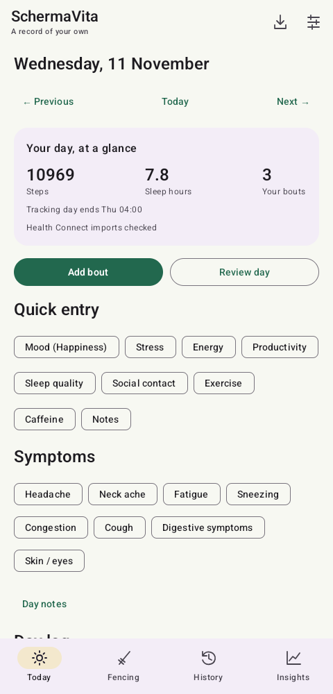
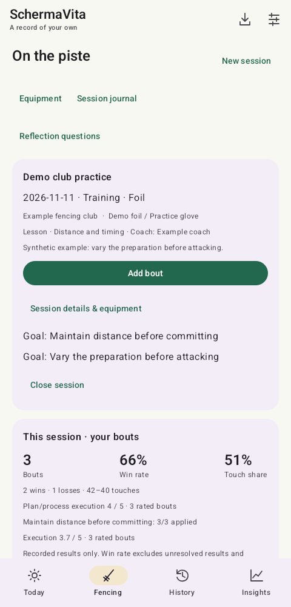
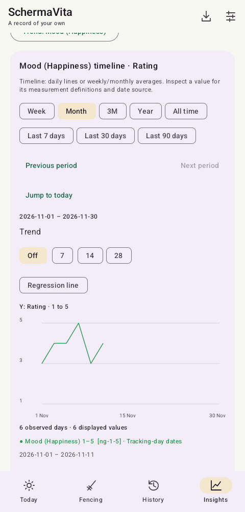
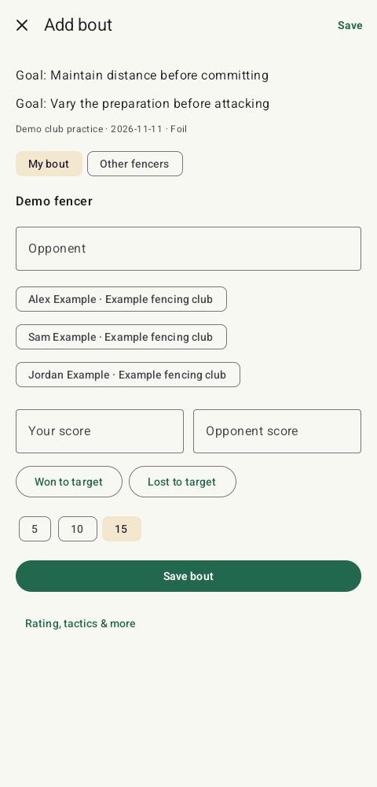
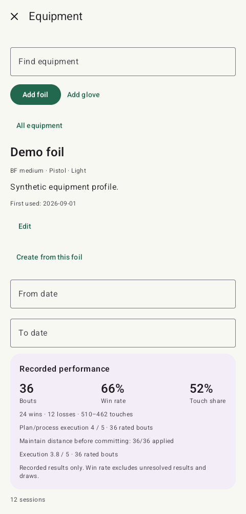
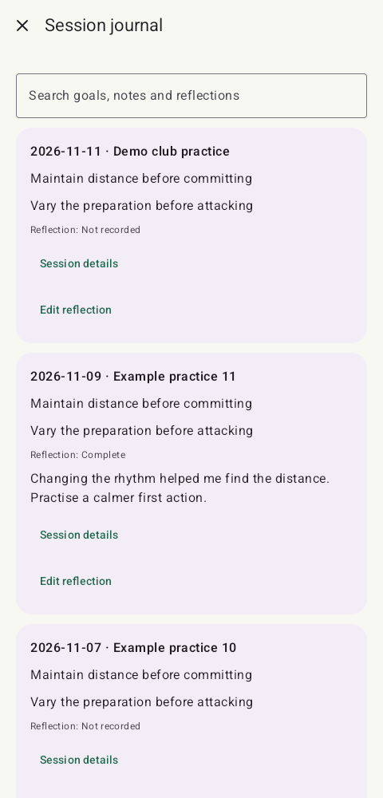

# SchermaVita

[English](README.md) · **Italiano**

**Un’app Android per registrare gli allenamenti di scherma e leggere i risultati alla luce delle abitudini quotidiane.**

SchermaVita riunisce preparazione, attrezzatura, lezioni, risultati degli assalti, diario quotidiano e grafici. Funziona senza account o server. I dati e il riconoscimento del testo nei documenti (OCR) restano sul dispositivo. I backup si esportano manualmente e si cifrano con una password. L’app non richiede il permesso di accesso a Internet.

È sviluppata con **Kotlin, Jetpack Compose, Room, coroutine e Flow, DataStore e WorkManager**. Le integrazioni con Health Connect e con l’accesso ai dati di utilizzo di Android sono facoltative.

## L’app in immagini

Le schermate sono state acquisite direttamente da **SchermaVita 0.7.2** l’11 novembre 2026. Tutti i dati mostrati, compresi quelli sulla salute, sono inventati.

| Diario quotidiano | Allenamento di scherma | Andamento nel tempo |
| --- | --- | --- |
|  |  |  |

| Inserimento rapido di un assalto | Scheda dell’attrezzatura | Diario degli allenamenti |
| --- | --- | --- |
|  |  |  |

Le [note sulle schermate](docs/screenshots/README.md) descrivono come sono state acquisite e quali dati di prova sono stati usati.

## Funzionalità

- **Registrare allenamenti e assalti.** Annota preparazione, avversari, punteggi, attrezzatura e lezioni. Gli obiettivi restano visibili mentre inserisci il risultato. Puoi scegliere un assalto a 5, 10 o 15 stoccate direttamente dal modulo. In **Rating, tactics & more** puoi valutare la prestazione, indicare quanto hai seguito il piano e rispondere per ciascun obiettivo.
- **Rileggere un allenamento.** Alla chiusura puoi aggiungere note e rispondere a domande ricorrenti con testo libero, un voto, un sì o un no oppure una scelta singola. Nel **Session journal** puoi cercare obiettivi, preparazione, lezioni, assalti e riflessioni.
- **Seguire la storia di ciascun attrezzo.** Ogni fioretto e guanto ha una scheda con nome, alias, caratteristiche e storico. Puoi segnalare una rottura, ritirare un attrezzo, unire duplicati o creare una nuova configurazione del fioretto mantenendo i collegamenti con gli assalti precedenti. Puoi confrontare singoli attrezzi, tipi di lama e impugnatura, angolazioni e caratteristiche aggiuntive.
- **Analizzare le prestazioni.** Esamina vittorie, sconfitte, quota di stoccate messe a segno, autovalutazioni e attuazione del piano per data, arma, formato, avversario e contesto. Combina i filtri su preparazione, uso di lenti a contatto, attrezzatura e riflessioni. Le schede sintetiche degli schermidori rimandano ai profili con valutazioni basate sui punteggi e relativo andamento nel tempo.
- **Tenere un diario quotidiano.** Configura gli indicatori, registra rapidamente i valori e rivedi la giornata. Puoi far terminare la giornata di registrazione dopo la mezzanotte. Ogni voce conserva la definizione della scala in uso al momento. Gli indicatori manuali facoltativi **Readiness** e **Sleep score** usano per impostazione predefinita una scala da 0 a 100.
- **Confrontare serie storiche.** Le versioni compatibili di un indicatore condividono lo stesso grafico. Puoi filtrare per versione o fonte e scegliere la vista combinata o separata (**Combined / Separate**). I vecchi dati **Mood** si possono leggere insieme ai dati compatibili **Mood (Happiness)**. Le serie per data di calendario restano distinte da quelle per giornata di registrazione.
- **Importare ed esportare.** Prima di salvare puoi verificare i risultati da CSV e XLSX o il testo estratto sul dispositivo da immagini e PDF. Puoi gestire i duplicati e annullare un’importazione. L’app conserva la provenienza dei dati e lascia indeterminati i punteggi sconosciuti. Puoi esportare un CSV o creare un backup cifrato con password che include attrezzatura, obiettivi, riflessioni e impostazioni.

### Come leggere i grafici

Il grafico si apre sul mese dell’ultima osservazione che soddisfa i filtri. **Week** e **Month** mostrano linee giornaliere, **3M** mostra medie settimanali per trimestre solare e **Year** e **All time** mostrano medie mensili. Puoi anche selezionare gli ultimi **7, 30 o 90 giorni**. Usa le frecce o scorri lateralmente per cambiare periodo. **Jump to today** riporta alla data odierna.

Nelle viste più ampie, **Individual days** mostra i singoli giorni come punti. Puoi sovrapporre medie mobili di **7, 14 o 28 giorni** e, separatamente, una retta di regressione lineare. I giorni senza osservazioni restano vuoti e la linea si interrompe se ne mancano almeno due consecutivi. Seleziona un valore per consultarne la fonte, la definizione della misura e il numero di giorni su cui si basa. I confronti tra due indicatori usano diagrammi di dispersione.

### Integrazioni facoltative

In **Health Connect** puoi attivare separatamente passi, durata e fasi del sonno, frequenza cardiaca a riposo, variabilità della frequenza cardiaca, frequenza respiratoria, saturazione di ossigeno e calorie attive o totali. Ogni indicatore mostra i propri permessi e lo stato della sincronizzazione. Disattivare un’importazione ne conserva lo storico. I punteggi **Readiness** e **Sleep score** si inseriscono manualmente.

Con **Usage Access** di Android, l’app può rilevare il tempo di utilizzo interattivo a schermo sbloccato, con aggiornamenti in primo piano e sincronizzazione in background. Entrambe le integrazioni sono di sola lettura. L’app non carica i dati su server, non scrive misurazioni in Health Connect e non integra il servizio cloud Google Health tramite OAuth.

## Scelte tecniche

| Problema | Soluzione adottata | Codice e test |
| --- | --- | --- |
| Un allenamento dopo mezzanotte può appartenere al giorno precedente. Il cambio dell’ora modifica la durata della giornata. | L’app salva l’istante effettivo, il giorno assegnato e il fuso orario originale. Cambiare l’orario di fine giornata conserva le assegnazioni già salvate. | [DayClock](core/src/main/kotlin/dev/riposte/core/Models.kt), [test sui confini della giornata](core/src/test/kotlin/dev/riposte/core/DayClockTest.kt) |
| Un cambio di attrezzatura o di scala può alterare l’interpretazione dei dati storici. | L’app conserva la configurazione dell’attrezzatura di ciascun partecipante al momento dell’assalto e associa ogni risposta alla versione della scala utilizzata. | [Definizioni degli indicatori](core/src/main/kotlin/dev/riposte/core/TrackerDefinitions.kt), [test sulla preparazione](fencing/src/test/kotlin/dev/riposte/fencing/SessionPreparationTest.kt) |
| I risultati importati possono essere incompleti, duplicati o riferiti ad altri schermidori. | L’importazione conserva provenienza e incertezza, prevede una revisione e tiene i risultati di terzi separati dai totali personali. | [Lettura delle tabelle](imports/src/main/kotlin/dev/riposte/imports/Tables.kt), [test dell’archivio](app/src/test/kotlin/dev/riposte/app/ArchiveTest.kt) |
| Una stima che tiene conto dell’avversario rischia di usare informazioni future. | I risultati privi di orario vengono elaborati per giornata. Le attese si calcolano sui giorni precedenti e le stime basate su pochi dati sono segnalate come provvisorie. | [Analisi degli assalti](insights/src/main/kotlin/dev/riposte/insights/FencingAnalysis.kt), [test dell’analisi](insights/src/test/kotlin/dev/riposte/insights/FencingAnalysisTest.kt) |
| Eliminando una funzione insieme ai suoi test, i test rimanenti possono continuare a passare. | Un inventario separato verifica i collegamenti delle funzionalità e l’identità dei singoli test. Durante il confezionamento si controllano le impronte dei sorgenti e dell’APK, la firma, i permessi e la versione. | [Requisiti di rilascio](tools/release-contract.json), [controllo del rilascio](tools/release-check.mjs), [analisi di una regressione](SCREEN_TIME_RESTORATION.md) |
| Un grafico fitto può nascondere gli andamenti o dare troppo peso ai giorni con più registrazioni. | Prima si calcola un valore giornaliero, poi si fa la media dei giorni osservati in ciascun periodo di calendario. Restano visibili le lacune e si conservano fonte e definizione della misura. | [Periodi e aggregazioni](life/src/main/kotlin/dev/riposte/life/ChartPeriods.kt), [test delle aggregazioni](life/src/test/kotlin/dev/riposte/life/ChartPeriodsTest.kt) |

## Architettura

La logica di dominio è separata dall’interfaccia Android e dalle integrazioni.

| Modulo | Responsabilità |
| --- | --- |
| `core` | Regole della giornata di registrazione, provenienza dei dati, definizioni degli indicatori e cifratura dei backup |
| `fencing` | Allenamenti, obiettivi, riflessioni, assalti, schede dell’attrezzatura e interfacce di accesso ai dati, indipendenti dal diario quotidiano e da Health Connect |
| `life` | Indicatori quotidiani, compatibilità delle scale storiche, aggregazioni per calendario e medie mobili |
| `insights` | Misure di prestazione, valutazioni degli schermidori e confronti tra indicatori osservati negli stessi giorni |
| `imports` | Lettura delle tabelle, gestione dei documenti e OCR |
| `health` | Lettura da Health Connect secondo i permessi concessi |
| `app` | Interfaccia Compose, persistenza con Room, preferenze DataStore e attività in background |

Il [repository basato su Room](app/src/main/kotlin/dev/riposte/app/Storage.kt) conserva record JSON indicizzati e applica in transazione le sole modifiche. L’interfaccia riceve lo stato tramite Flow. I backup usano PBKDF2-HMAC-SHA256 e AES-256-GCM. Il backup cloud e il trasferimento automatico tra dispositivi Android sono disattivati.

## Compilare e provare l’app

Servono **JDK 21** e **Android SDK Platform 36**. Configura il percorso dell’SDK tramite `ANDROID_HOME` o Android Studio. Il wrapper incluso usa **Gradle 8.13**. Il progetto usa **Kotlin 2.1.20** e **Android Gradle Plugin 8.13.0**. La versione minima supportata è **Android 9 (API 28)** e il livello API di destinazione è **36**.

Apri il progetto in Android Studio oppure, su Windows, esegui questi comandi dalla cartella principale del progetto.

```powershell
New-Item -ItemType Directory -Force .tools | Out-Null
node tools/release-check.mjs source
.\gradlew.bat :core:test :fencing:test :life:test :insights:test :imports:testDebugUnitTest :app:testDebugUnitTest :app:assembleDebug :app:assembleDebugAndroidTest :app:lintDebug
```

Il controllo dei requisiti di rilascio richiede Node.js. Su macOS e Linux usa `mkdir -p .tools` per creare la cartella e `bash ./gradlew` per eseguire Gradle. La compilazione standard genera l’APK di debug in `app/build/outputs/apk/debug/`. Puoi installarlo su un emulatore o su un dispositivo di sviluppo. Il repository non include un APK precompilato né la chiave di firma del rilascio.

Per provare l’interfaccia, crea un allenamento in **Fencing**, aggiungi un avversario fittizio e un assalto, poi apri **Insights**. Per il diario quotidiano, apri **Today**. La [guida all’uso](docs/USER_GUIDE.md) descrive importazioni, integrazioni, backup e configurazione.

## Verifica

La versione **0.7.2 (codice 12)** è stata verificata il **10 novembre 2026**. Sono passati tutti i **71 test unitari** e i **22 test su emulatore**, inclusi i controlli su uno storico privato. Lint non ha segnalato errori. Sono riusciti anche la compilazione con i controlli di rilascio e l’aggiornamento su emulatore. La versione mantiene l’identificativo dell’app e la chiave di firma precedenti. I grafici integrano i dati storici compatibili di **Mood** e **Mood (Happiness)** e consentono di esplorare valori giornalieri e medie settimanali o mensili, visualizzare i punti giornalieri e tornare a oggi. Consulta i [risultati della verifica](VALIDATION.md) e la [guida all’uso](docs/USER_GUIDE.md).

I controlli di rilascio richiedono **93 test identificati singolarmente**. Nell’aggiornamento su emulatore dal codice 11 al 12, tutti i **38 hash** del database e dei file privati sono rimasti invariati prima del primo avvio. Il processo di confezionamento ha verificato la corrispondenza fra sorgenti e APK, la firma, l’allineamento, i permessi e la versione. I risultati delle versioni precedenti sono raccolti nel [registro delle verifiche](VALIDATION.md).

Due test richiedono uno storico privato fornito separatamente. In sua assenza vengono saltati, quindi un’esecuzione sui soli dati pubblici copre una parte dei controlli di rilascio. I test unitari e quelli dell’interfaccia con dati sintetici sono inclusi nei sorgenti. Gli script Windows originali per il rilascio richiedono strumenti predisposti separatamente nella cartella `.tools`. Per una compilazione ordinaria puoi usare Android Studio o il wrapper Gradle. Consulta i [dettagli sulla copertura delle verifiche](VALIDATION.md).

## Limiti e stato del progetto

SchermaVita è un progetto personale, alla versione **0.7.2**. La cronologia delle prime fasi di sviluppo è conservata privatamente per proteggere i dati di test. Le schermate dimostrative non documentano una sincronizzazione reale con Health Connect.

Le valutazioni degli schermidori e le correlazioni sono stime descrittive basate sui dati registrati. Non costituiscono classifiche ufficiali e non dimostrano rapporti di causa ed effetto. Le osservazioni mancanti restano tali.

Per questa versione candidata al rilascio non è stata scelta una licenza dell’applicazione. Gli avvisi relativi ai componenti di terze parti sono conservati. La pubblicazione dell’app e la scelta della licenza restano decisioni distinte e l’esportazione dei sorgenti non pubblica automaticamente l’app.
