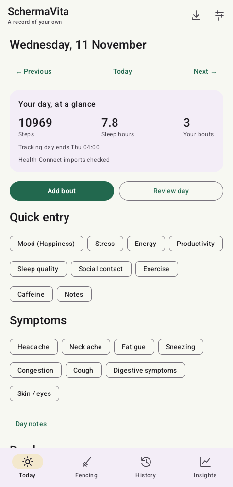
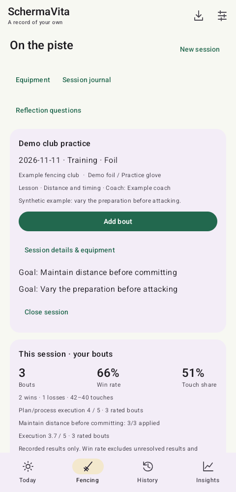
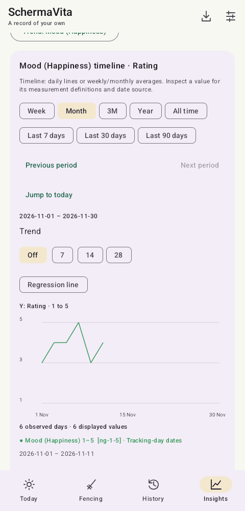
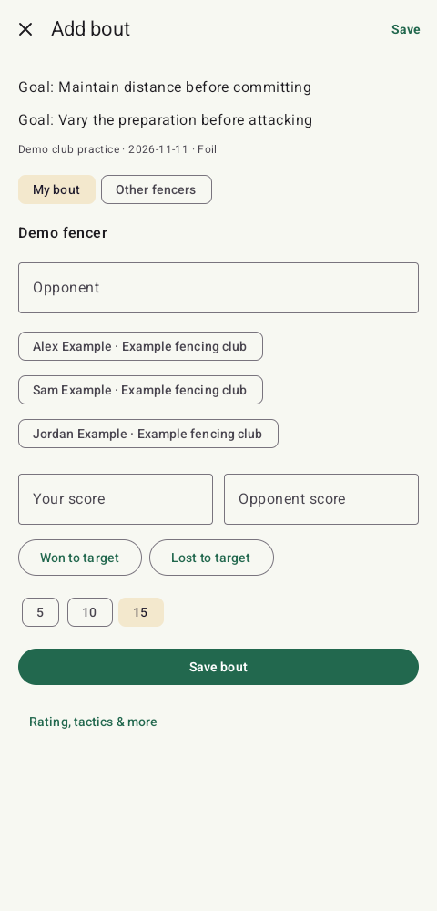
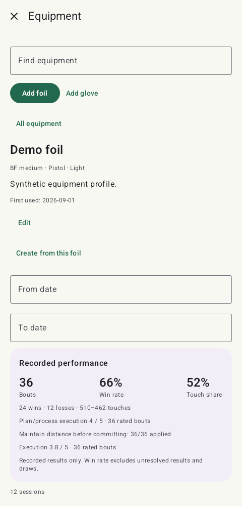
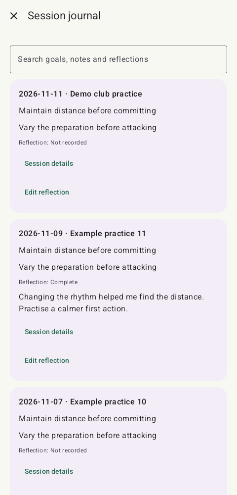

# SchermaVita

**An Android app for recording fencing practice and exploring performance alongside daily context.**

SchermaVita brings session preparation, equipment, lessons, bout results, daily logs and local charts into one app. It works without an account or server: records stay on the device, document OCR runs on-device, and backups are exported manually with password-based encryption. The app does not request internet permission.

Built with **Kotlin, Jetpack Compose, Room, coroutines/Flow, DataStore and WorkManager**, with optional Health Connect and Android Usage Access integrations.

## A quick look

These are direct captures of **SchermaVita 0.7.2**, taken on 11 November 2026 with entirely invented data. They show the running Android app, not mockups. No personal records or live health measurements are shown.

| Daily logging | Fencing practice | Navigable timelines |
| --- | --- | --- |
|  |  |  |

| Fast bout entry | Individual equipment | Session journal |
| --- | --- | --- |
|  |  |  |

Screenshot provenance and the fixture are documented in [the screenshot notes](docs/screenshots/README.md).

## What it does

- **Log fencing sessions and bouts:** record preparation, opponents, scores, equipment and lessons. Keep session goals visible while entering scores; choose a 5/10/15 target without expanding details. Subjective performance, plan/process execution and per-goal answers live under **Rating, tactics & more**.
- **Reflect and revisit:** closing a session opens optional notes and recurring questions. Question templates support text, rating, yes/no and single choice. The searchable **Session journal** brings together goals, preparation, lessons, bouts and saved reflections.
- **Track individual equipment:** foil and glove profiles retain names, aliases, properties and history. Mark items broken/retired, merge duplicates, or create a new foil configuration while retaining previous associations. Compare individual items, blade/handle types, set angles and extra properties.
- **Filter recorded performance:** inspect wins/losses, touch share, subjective performance and process execution by date, weapon, format, opponent and session context. Combine preparation, contact-lens, equipment and reflection filters. Fencer profiles contain current score ratings and rating-history charts; list cards stay compact.
- **Keep daily context:** use configurable trackers, quick entries and daily reviews, with a tracking-day boundary that can extend past midnight. Scale revisions preserve the definitions attached to older entries. Optional manual **Readiness** and **Sleep score** trackers default to 0–100.
- **Explore quieter charts:** compatible historical/current revisions share charts, with revision/source filters and **Combined / Separate** views. Historical Mood joins compatible Mood (Happiness) data. Calendar dates and tracking-day dates remain distinct analytical series.
- **Import and export:** review CSV/XLSX results and on-device image/PDF OCR before saving, with duplicate handling and undo. Preserve provenance and unknown scores. Export CSV or password-encrypted backups containing equipment, goals, reflections and settings.

### Chart views

Charts open in the month containing the latest matching observation. **Week** and **Month** show daily lines; **3M** shows weekly averages within a calendar quarter; **Year** and **All time** show monthly averages. Trailing **7 / 30 / 90-day** windows are also available. Use arrows or swipes to browse, and **Jump to today** to return to the present.

Longer views offer **Individual days** to restore daily dots. Optional **7 / 14 / 28-day rolling means** and independent linear regression appear above observations. Missing days are not zero; daily lines break across two or more missing days. Tap or inspect values for their source, measurement definition and contributing-day count. Metric-versus-metric comparisons remain scatter plots.

### Optional integrations

Health Connect has independent switches for **steps, sleep duration/stages, resting heart rate, heart-rate variability, respiratory rate, oxygen saturation, and active/total calories**. Permissions and sync status are shown per metric; disabling an import retains its history. Readiness and Sleep score are manual trackers, not imported provider scores.

Android **Usage Access** can supply interactive, unlocked screen time, with foreground refresh and background sync. The app reads these integrations without uploading records or writing health measurements back. Google Health cloud/OAuth integration is not included.

## Engineering decisions worth inspecting

| Problem | Approach | Where to look |
| --- | --- | --- |
| A late-night session can belong to the previous tracking day; daylight-saving transitions change its duration. | Store actual instants, a day label and the original timezone. Resolve configurable boundaries without rewriting saved days. | [DayClock](core/src/main/kotlin/dev/riposte/core/Models.kt), [day-clock tests](core/src/test/kotlin/dev/riposte/core/DayClockTest.kt) |
| Editing equipment or a rating scale must not change what an older record meant. | Snapshot participant equipment and retain versioned tracker definitions with saved answers. | [Tracker definitions](core/src/main/kotlin/dev/riposte/core/TrackerDefinitions.kt), [session tests](fencing/src/test/kotlin/dev/riposte/fencing/SessionPreparationTest.kt) |
| Imported results may be incomplete, duplicated or about other fencers. | Preserve provenance and uncertainty; review before saving; keep third-party results separate from personal totals. | [Import parsing](imports/src/main/kotlin/dev/riposte/imports/Tables.kt), [archive tests](app/src/test/kotlin/dev/riposte/app/ArchiveTest.kt) |
| Opponent-adjusted analysis can accidentally use future evidence. | Process date-only results in day batches and calculate expectations from earlier days. Mark sparse baselines provisional. | [Fencing analysis](insights/src/main/kotlin/dev/riposte/insights/FencingAnalysis.kt), [analysis tests](insights/src/test/kotlin/dev/riposte/insights/FencingAnalysisTest.kt) |
| A passing test count can hide a removed feature if its tests disappeared too. | Check a separate inventory of feature wiring and exact test identities, then verify source/APK fingerprints, signing, permissions and version at packaging. | [Release contract](tools/release-contract.json), [release guard](tools/release-check.mjs), [regression case study](SCREEN_TIME_RESTORATION.md) |
| Dense timelines can obscure patterns or over-weight days with multiple entries. | Resolve daily values first, then average observed days into calendar buckets; retain source/definition provenance and explicit gaps. | [Chart periods and buckets](life/src/main/kotlin/dev/riposte/life/ChartPeriods.kt), [bucket tests](life/src/test/kotlin/dev/riposte/life/ChartPeriodsTest.kt) |

## Architecture

The project separates domain logic from Android UI and integrations:

| Module | Responsibility |
| --- | --- |
| `core` | Tracking-day rules, provenance, tracker definitions and backup encryption |
| `fencing` | Sessions, goals, reflections, bouts, equipment profiles and repository contracts; independent of life logging and Health Connect |
| `life` | Daily metrics, compatible historical scales, calendar buckets and rolling means |
| `insights` | Performance measures, fencer ratings and matched-day comparisons |
| `imports` | Table parsing and document/OCR support |
| `health` | Permission-aware Health Connect reads |
| `app` | Compose UI, Room persistence, DataStore preferences and background work |

The [Room repository](app/src/main/kotlin/dev/riposte/app/Storage.kt) stores indexed JSON records and applies transactional differential updates. UI state is exposed through flows. Backups use PBKDF2-HMAC-SHA256 and AES-256-GCM; Android cloud backup/device transfer is disabled.

## Build and try it

Requirements: **JDK 21**, Android SDK platform **36**, and an SDK installation configured through `ANDROID_HOME` or Android Studio. The included wrapper uses Gradle **8.13**; the project pins Kotlin **2.1.20** and Android Gradle Plugin **8.13.0**. Minimum Android version: **9 / API 28**; target: **API 36**.

Open the project in Android Studio, or run from the project root on Windows:

```powershell
New-Item -ItemType Directory -Force .tools | Out-Null
node tools/release-check.mjs source
.\gradlew.bat :core:test :fencing:test :life:test :insights:test :imports:testDebugUnitTest :app:testDebugUnitTest :app:assembleDebug :app:assembleDebugAndroidTest :app:lintDebug
```

Node.js is needed for the release-contract check. On macOS/Linux use `bash ./gradlew` in place of `.\gradlew.bat`, and `mkdir -p .tools` in place of `New-Item`. The debug APK is generated under `app/build/outputs/apk/debug/` in a standard build. Install it on an emulator or a development device; no APK or release signing key is included in this export.

To explore the UI, create a session under **Fencing**, add a fictional opponent and bout, then open **Insights**. Daily entries are available under **Today**. The [user guide](docs/USER_GUIDE.md) covers imports, integrations, backup and configuration.

## Verification

Version **0.7.2 (code 12)** was validated on **10 November 2026**: all **71 unit tests** and **22 emulator tests** passed, including private-history checks. Lint reported no errors. The guarded build and emulator upgrade checks passed; the release uses the existing application ID and signing key. Historical Mood joins compatible Mood (Happiness) charts. Time-series charts now use navigable daily lines and weekly/monthly averages, with optional daily dots and Jump to today. See [validation details](VALIDATION.md) and the [updated user guide](docs/USER_GUIDE.md).

The release contract requires **93 exact test identities**. An in-place emulator upgrade from code 11 to code 12 preserved all **38 database/private-file hashes** before first launch. The guarded packager verified source/APK consistency, signing, alignment, permissions and version. Earlier release results remain in [VALIDATION.md](VALIDATION.md).

Two retained tests use a separately supplied private history fixture. They skip when it is absent; public runs without it are not equivalent to the complete maintainer release gate. Synthetic unit/UI tests remain in source. The original Windows release scripts expect a separately provisioned `.tools` toolchain; normal source builds can use Android Studio or the Gradle wrapper above. See [validation scope](VALIDATION.md).

## Limits and project status

This is a personal project, version **0.7.2**. Earlier development history is retained privately to protect private test inputs. Screenshots are demonstrations, not evidence of live Health Connect synchronization.

Fencer ratings and correlations are descriptive estimates from recorded data, not official rankings or causal findings. Missing observations are not filled. Physical-device Health Connect behavior, OEM background scheduling, handwriting accuracy and real entry speed still need hands-on verification.

No application license has been selected for this unpublished candidate. Existing third-party notices are retained. Publication and licensing remain separate decisions; nothing in this export has been published automatically.
