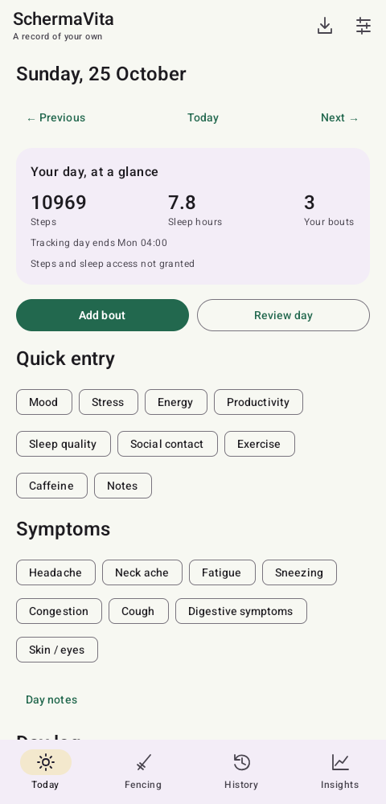
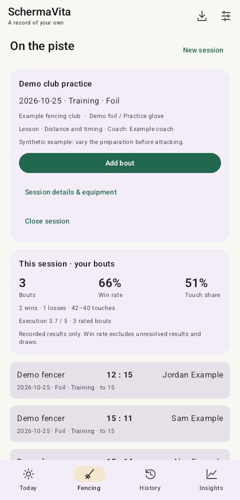
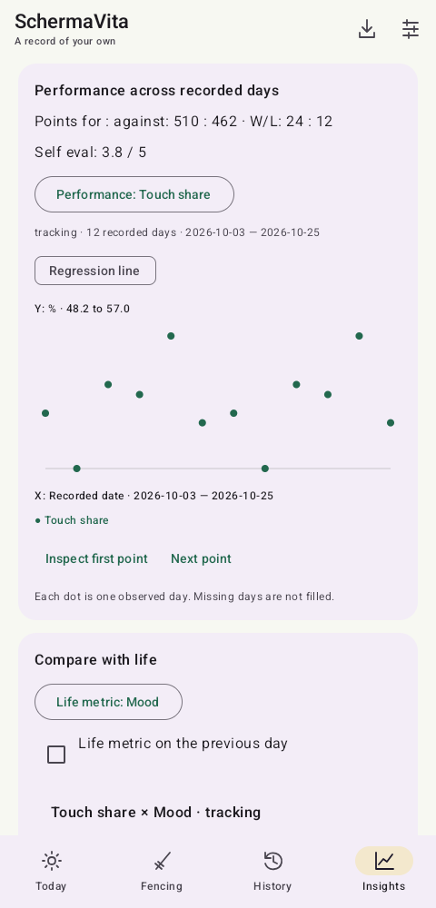

# SchermaVita

**An Android app for recording fencing practice and exploring performance alongside daily context.**

SchermaVita brings session preparation, equipment, lessons, bout results, daily logs and local charts into one app. It works without an account or server: records stay on the device, document OCR runs on-device, and backups are exported manually with password-based encryption. The app does not request internet permission.

Built with **Kotlin, Jetpack Compose, Room, coroutines/Flow, DataStore and WorkManager**, with optional Health Connect and Android Usage Access integrations.

## A quick look

These are actual emulator captures of the app, populated entirely with invented data. Names, scores and daily values are synthetic; the screenshots do not show personal records or live health measurements.

| Daily logging | Fencing practice | Performance insights |
| --- | --- | --- |
|  |  |  |

Screenshot provenance and the fixture are documented in [the screenshot notes](docs/screenshots/README.md).

## What it does

- **Record a practice session:** set preparation and equipment once, record bouts and lessons, then close and resume the same session without losing its history.
- **Keep daily context:** configurable rating scales, quick entries and daily reviews, with a tracking-day boundary that can extend past midnight.
- **Review imported results:** CSV/XLSX tables and on-device image/PDF OCR, followed by editable review, duplicate handling and undo. Missing scores stay unknown.
- **Explore recorded performance:** touch share, win/loss measures, self-evaluation, local fencer ratings and comparisons with daily metrics. Points can be inspected by date and sample count.
- **Control integrations and exports:** opt-in steps/sleep reads, optional unlocked-screen-time totals, encrypted backups and CSV exports.

## Engineering decisions worth inspecting

| Problem | Approach | Where to look |
| --- | --- | --- |
| A late-night session can belong to the previous tracking day; daylight-saving transitions change its duration. | Store actual instants, a day label and the original timezone. Resolve configurable boundaries without rewriting saved days. | [DayClock](core/src/main/kotlin/dev/riposte/core/Models.kt), [day-clock tests](core/src/test/kotlin/dev/riposte/core/DayClockTest.kt) |
| Editing equipment or a rating scale must not change what an older record meant. | Snapshot participant equipment and retain versioned tracker definitions with saved answers. | [Tracker definitions](core/src/main/kotlin/dev/riposte/core/TrackerDefinitions.kt), [session tests](fencing/src/test/kotlin/dev/riposte/fencing/SessionPreparationTest.kt) |
| Imported results may be incomplete, duplicated or about other fencers. | Preserve provenance and uncertainty; review before saving; keep third-party results separate from personal totals. | [Import parsing](imports/src/main/kotlin/dev/riposte/imports/Tables.kt), [archive tests](app/src/test/kotlin/dev/riposte/app/ArchiveTest.kt) |
| Opponent-adjusted analysis can accidentally use future evidence. | Process date-only results in day batches and calculate expectations from earlier days. Mark sparse baselines provisional. | [Fencing analysis](insights/src/main/kotlin/dev/riposte/insights/FencingAnalysis.kt), [analysis tests](insights/src/test/kotlin/dev/riposte/insights/FencingAnalysisTest.kt) |
| A passing test count can hide a removed feature if its tests disappeared too. | Check a separate inventory of feature wiring and exact test identities, then verify source/APK fingerprints, signing, permissions and version at packaging. | [Release contract](tools/release-contract.json), [release guard](tools/release-check.mjs), [regression case study](SCREEN_TIME_RESTORATION.md) |

## Architecture

The project separates domain logic from Android UI and integrations:

| Module | Responsibility |
| --- | --- |
| `core` | Tracking-day rules, provenance, tracker definitions and backup encryption |
| `fencing` | Sessions, bouts, equipment snapshots and repository contracts; independent of life logging and Health Connect |
| `life` | Daily metrics, historical scales and aggregation rules |
| `insights` | Performance measures, fencer ratings and matched-day comparisons |
| `imports` | Table parsing and document/OCR support |
| `health` | Permission-aware Health Connect reads |
| `app` | Compose UI, Room persistence, DataStore preferences and background work |

The [Room repository](app/src/main/kotlin/dev/riposte/app/Storage.kt) stores indexed JSON records and applies transactional differential updates. UI state is exposed through flows. Backups use PBKDF2-HMAC-SHA256 and AES-256-GCM; Android cloud backup/device transfer is disabled.

## Build and try it

Requirements: **JDK 21**, Android SDK platform **36**, and an SDK installation configured through `ANDROID_HOME` or Android Studio. The included wrapper uses Gradle **8.13**; the project pins Kotlin **2.1.20** and Android Gradle Plugin **8.13.0**. Minimum Android version: **9 / API 28**; target: **API 36**.

Open the project in Android Studio, or run from the project root on Windows:

```powershell
New-Item -ItemType Directory -Force .tools | Out-Null
node tools/release-check.mjs source
.\gradlew.bat :core:test :fencing:test :life:test :insights:test :imports:testDebugUnitTest :app:testDebugUnitTest :app:assembleDebug :app:assembleDebugAndroidTest :app:lintDebug
```

Node.js is needed for the release-contract check. On macOS/Linux use `bash ./gradlew` in place of `.\gradlew.bat`, and `mkdir -p .tools` in place of `New-Item`. The debug APK is generated under `app/build/outputs/apk/debug/` in a standard build. Install it on an emulator or a development device; no APK or release signing key is included in this export.

To explore the UI, create a session under **Fencing**, add a fictional opponent and bout, then open **Insights**. Daily entries are available under **Today**. The [user guide](docs/USER_GUIDE.md) covers imports, integrations, backup and configuration.

## Verification

The application source in this export was validated on **25 October 2026**:

- **53 unit tests passed**, with zero failures, errors or skips.
- **All 13 Android emulator tests passed together**, including historical import, screen-time behavior, photo import, equipment/tracker revisions and closing/resuming sessions.
- Debug, instrumentation and signed release builds succeeded. Debug lint reported **zero errors**, 16 warnings and 3 hints.
- The guarded packager verified the source/APK fingerprints, required test identities, existing signing certificate, alignment, Usage Access permission, application ID and version.

The **0.6.2 rename on 25 October 2026** changes the display name from Riposte to SchermaVita and refreshes the synthetic screenshots. All **66 required test identities** are preserved. An in-place emulator update from code 7 to code 8 preserved existing database/private-file hashes before first launch. The package ID, stored formats and signing key remain unchanged for update compatibility.

Two retained tests use a separately supplied private history fixture. They skip when it is absent; public runs without it are not equivalent to the complete maintainer release gate. Synthetic unit/UI tests remain in source. The original Windows release scripts expect a separately provisioned `.tools` toolchain; normal source builds can use Android Studio or the Gradle wrapper above. See [validation scope](VALIDATION.md).

## Limits and project status

This is a personal project and a reviewed source snapshot, version **0.6.2**. Earlier development history is retained privately to protect private test inputs. Screenshots are demonstrations, not evidence of live Health Connect synchronization.

Fencer ratings and correlations are descriptive estimates from recorded data, not official rankings or causal findings. Missing observations are not filled.

No application license has been selected for this unpublished candidate. Existing third-party notices are retained. Publication and licensing remain separate decisions; nothing in this export has been published automatically.
